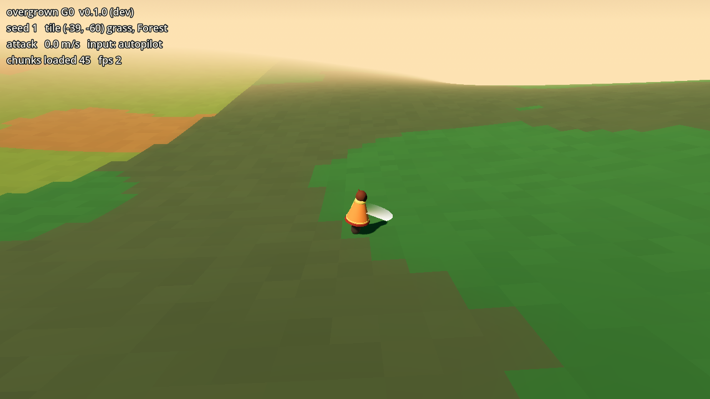

# overgrown

An open-source, desktop, real-time hack-and-slash sandbox RPG for you and a few friends (OQ-029), made in Godot 4 (OQ-031) and shipped as an exe from GitHub Releases (OQ-032).

A cozy, saturated, painted world where you are *just another one*: NPCs live, learn, trade, migrate and die by the same rules you do. Monsters age, breed and take over land if nobody pushes back. Wander too far, or let an area grow wild, and the lovely world turns into hell difficulty.

- **A desktop game for a few friends** (typically 2, up to ~4): no phone or public-link target, no accounts (OQ-029).
- **One-machine-hosts multiplayer**: solo is just a world nobody has joined yet. Open it to friends and they join the host over LAN or the internet.
- **Everything is ours or credited**: we make the art and audio by any method, and any third-party file has a licence we can ship and an entry in [`game/assets/third_party/CREDITS.md`](game/assets/third_party/CREDITS.md) (OQ-038).

## Play

Download `overgrown-windows.exe` from the newest build on the [Releases page](https://github.com/LucidPaths/overgrown/releases): the rolling ["latest (main)" pre-release](https://github.com/LucidPaths/overgrown/releases/tag/latest) is rebuilt on every merge to `main`, and `v*` tags are versioned releases. Then double-click it. Nothing else to install.

The exe is not signed, so the first time Windows SmartScreen says "unknown publisher". Click **More info**, then **Run anyway**.

Linux: download `overgrown-linux.x86_64`, run `chmod +x overgrown-linux.x86_64`, then `./overgrown-linux.x86_64`.

## What you can do right now



Milestone G0 is the foundation: a seeded, endless 3D world that streams in around you (grassland, forest, rivers, coasts, terraced mountains with cliffs) and a placeholder wanderer you can walk, sprint, dodge-roll and swing with. Cliffs and deep water block you, shallow water slows you. Colours and the character are stand-ins; the painted look from the mood board ([`docs/art/moodboard/`](docs/art/moodboard/)) and the real wanderer come in G1.

| Action | Keyboard and mouse | Gamepad |
|---|---|---|
| Move | WASD or arrow keys | left stick |
| Sprint (hold) | Shift | LB or left stick click |
| Dodge roll | Space | B (east button) |
| Attack (toward the cursor or right stick) | left click | X (west button) or RT |
| Aim | mouse | right stick |
| Zoom | mouse wheel | |
| Vista view (hold) | V | Y (north button) |

Whichever device you touched last is the one in use.

## Roadmap

From [`docs/overhaul/PLAN.md`](docs/overhaul/PLAN.md); tasks and their checklists are in [`docs/agents/MILESTONES.md`](docs/agents/MILESTONES.md).

- **G0, Foundation (now):** Godot project, the release exe, the seeded world in 3D, the character rules and controls.
- **G1, The look:** one biome and one vista that look like the mood board, with the real wanderer in motion.
- **G2, First fight:** monsters that spawn and age, stamina and hit feel, weapons, levels, items, a HUD, the first sounds.
- **G3, Co-op:** you host from the game menu and a friend joins over the internet, with a shared world save.
- **Then** the rest of the GDD: NPCs, dungeons, ecology and so on.

The design lives in [`docs/gdd/`](docs/gdd/README.md). Every task there has a stable ID; when a PR implements one, its box gets ticked with the PR linked next to it ([the workflow](docs/gdd/README.md#workflow)).

## Develop

Everything happens through the scripts in `tools/godot/` (Ubuntu; the cloud sessions run `setup.sh` automatically):

```
bash tools/godot/setup.sh            # installs Godot 4.7.2 and Blender
bash tools/godot/test.sh             # headless GDScript tests
bash tools/godot/export.sh           # Windows and Linux builds into game/export/
bash tools/godot/capture.sh out.png  # a screenshot of the main scene (xvfb, software rendering; run test.sh first so new scripts are imported)
```

Agents start from [`CLAUDE.md`](CLAUDE.md).

## License

MIT, for code and authored assets alike. Third-party assets keep their own licences, listed in `game/assets/third_party/CREDITS.md`.
