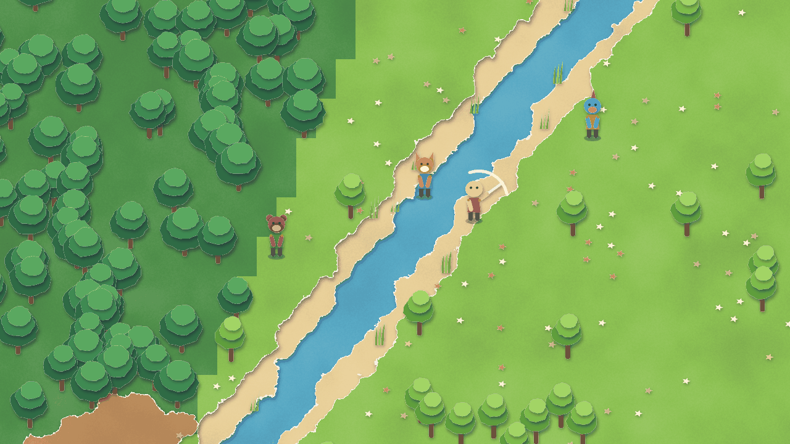
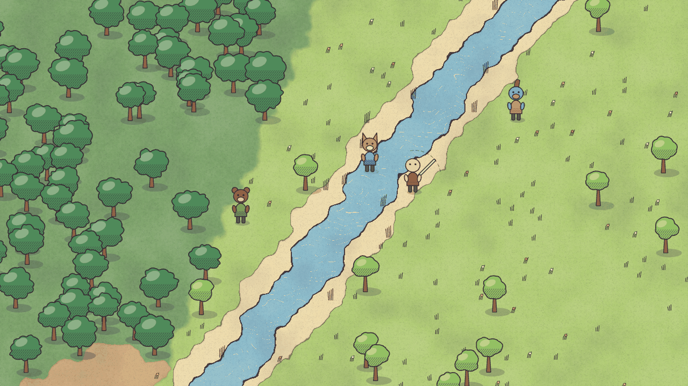
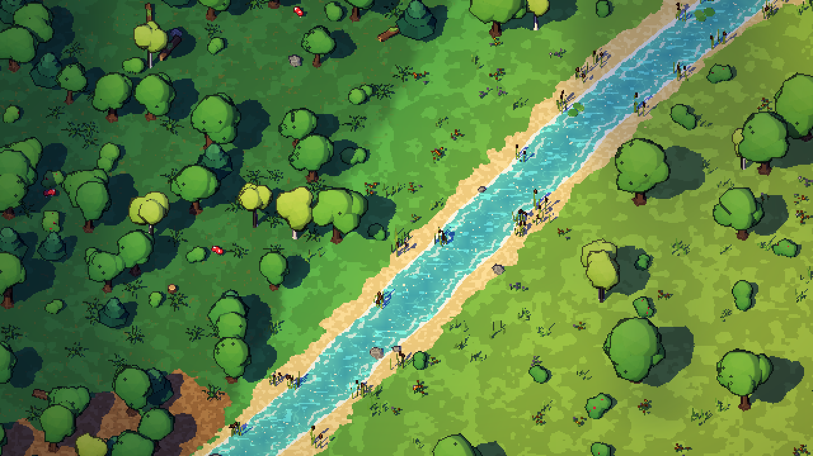
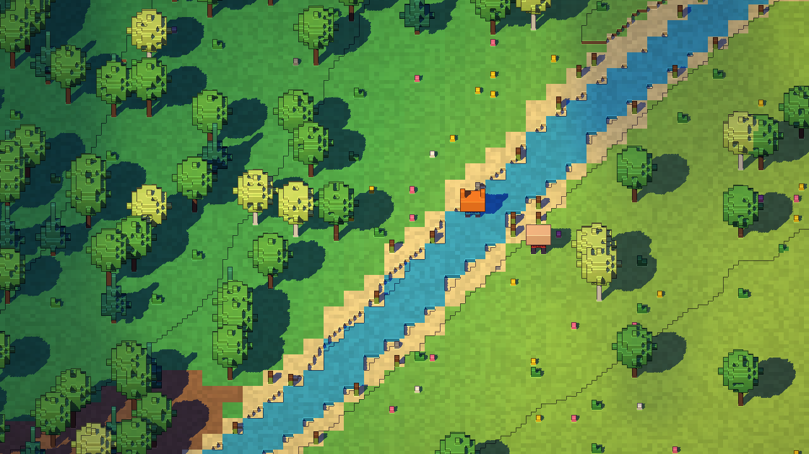
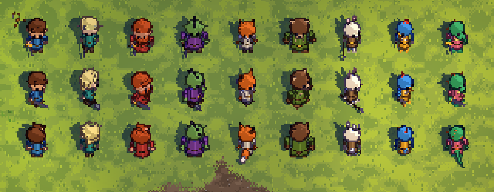
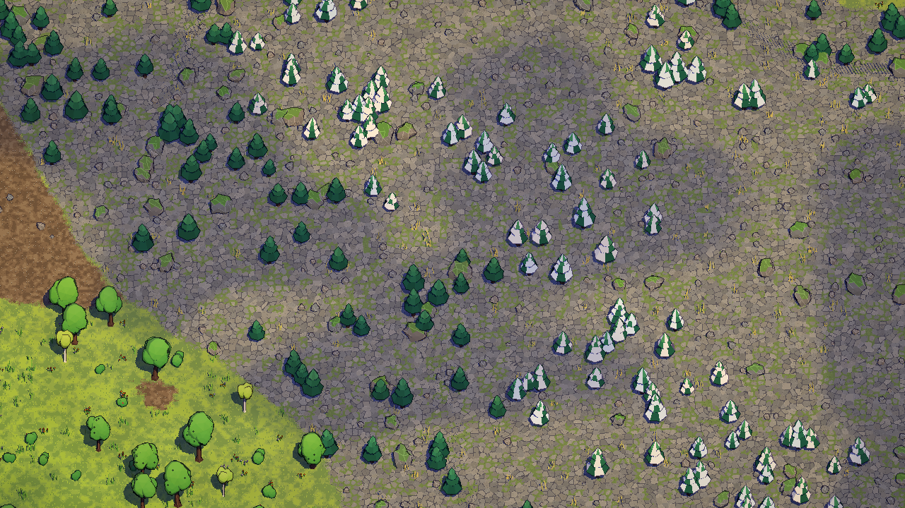
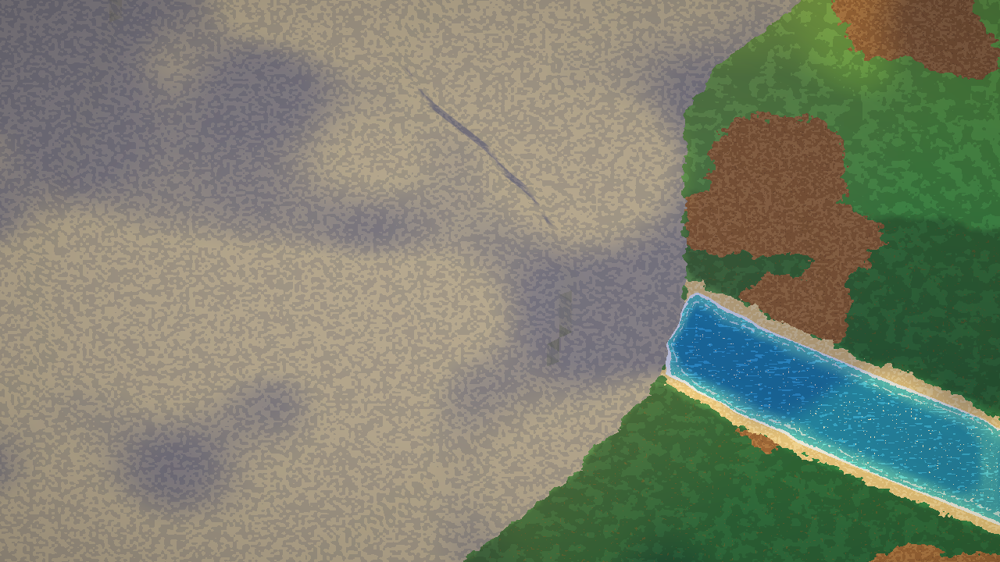

# ART-025 explorations: what I tried and why it died

Four directions were sketched on the same seeded spot (seed 22: forest | river | meadow), so they could be compared
honestly. The sketch code is still runnable: `art-lab/sketch.html?d=paper|ink|voxel`. Inside the chosen direction,
several sub-decisions were also tried and dropped. They are listed at the end.

## Paper theatre (killed)

Every terrain class is a sheet of torn paper, stacked by height with drop shadows. Trees are stacked paper discs and
characters are flat cut-out puppets.

**Why it died.** It is charming in a still and dead in motion. There is no light to change, so no dusk, no night
and no weather beyond swapping palettes. Every boundary is the same torn edge, so across endless terrain the edges
become wallpaper. The puppets cannot turn: four facings means four drawings per gear piece, the sprite-sheet
explosion the GDD's layered armour cannot afford.

## Ink and wash storybook (killed)

Watercolour washes with pooled edges on cream paper, a wobbly ink line on every boundary, hatching for shade, and
inked figures.

**Why it died.** It is the prettiest still. But the wash and the line are made per frame from noise, so a moving
camera makes the paper swim, or the texture has to be locked to the world and then looks like a printed carpet. The
hit, the roll and the slash have nowhere to live in a quiet storybook look, and a fight goes muddy. It is also the
most expensive to draw per pixel on a phone.

## Pixel diorama (kept)

This is the previous run's first diorama frame, before characters and before the material pass. Even bare, it had
what the others lacked: real light and shadow, wind, flowing water, and a single pixel grid that holds in motion.
Every later image grows from it.

## Voxel diorama (killed)

The same relief and props voxelised at 4 px and rendered smooth.

**Why it died.** It reads as Minecraft at once, and the sim is a free 2D plane with diagonal rivers. A 4 px stair
step on every slope and shore fights the movement the player actually has. The cubes also make trees and people
too blocky to carry faces or species at 28 px.

## Inside the diorama: dead ends

### No lean, no tilt

A 52 deg camera shows the tops of heads: hats and hair, no faces. Lowering the whole camera would squash the ground
map. The fix is to lean upright things back toward the camera, as A Link Between Worlds does, and to tilt
characters 18 deg more. Faces appear and the ground stays a readable map (compare `img/species-lineup.png`).

### Flagstone mountains

The first rock material was a dense Voronoi pavement, which looked like a paved courtyard laid over a mountain. It
was replaced by big calm slabs with a few long seams, gravel in hollows and alpine grass. The sim's sparse cliff
tiles were also invisible on a flat plain. They became jittered rock columns that read as ridges and passes.

### First mountain and dirt pass

The earlier mountain was a grey camo plane with blurred cloud shadows and no form. The dirt was saturated orange
and filled huge patches with nothing on them. Both were reworked:
- earth: muted soil with pebbles, dry tufts and stumps;
- rock: slabs, ridges and a snow line.

### Smaller dead ends

- **Billboard dither colours.** A pale yellow silhouette over light foliage read as noise. It is now a saturated
  team colour with two-tone shading.
- **The roll dipped through the ground.** It is now a tucked ball turning about its own centre with a 6 px hop.
- **Ocean ripple dashes everywhere.** These were too busy. The sea is now flat depth bands with sparse, slow
  highlights.
- **A 2048 shadow map at the old 640x360 framing.** At the new closer framing, 1024 gives about one world px per
  shadow texel, for a quarter of the fill.
