# ART-025 art lab: the pixel diorama

The world is real low-poly 3D, built from the seed and lit by one sun. It is drawn into a buffer where one texel is
one world pixel, outlined, and scaled up by a whole number. It reads as pixel art and behaves like a place: light,
wind, water, time of day, lanterns, and hits that spark. Every image here comes from code in `art-lab/`; there
are no asset files.

| Document | What it is |
|---|---|
| [DIRECTION.md](DIRECTION.md) | The art bible: philosophy, pipeline, rules, recipes. |
| [INTEGRATION.md](INTEGRATION.md) | What bringing it into the game takes, with measured numbers. |
| [EXPLORATION.md](EXPLORATION.md) | The directions I tried and killed. |
| [RESEARCH.md](RESEARCH.md) | Sources and what I took from each. |
| [PROGRESS.md](PROGRESS.md) | The work log. |
| [`art-lab/README.md`](../../../art-lab/README.md) | How to run the prototype. |

## Start here

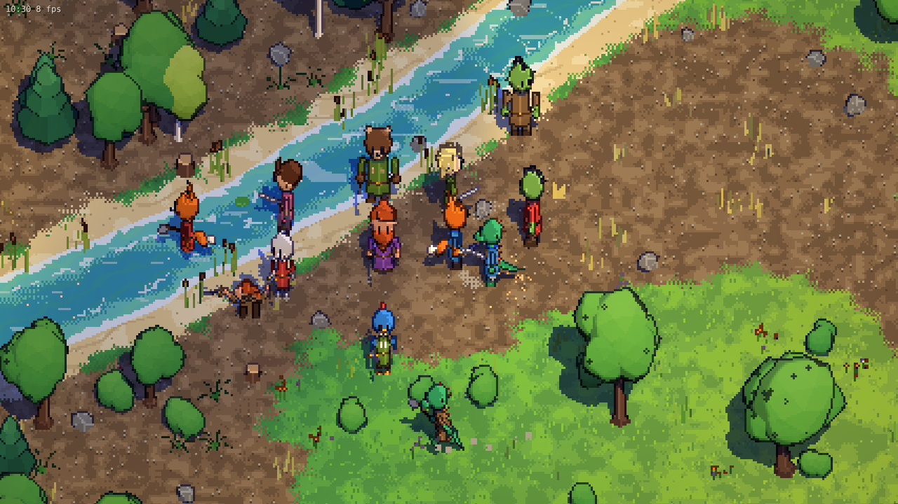
*The live prototype at 1280x720 (3 device px per texel), seed 22 spawn: meadow, river and forest. A foxfolk player
(centre) and NPCs of every species run on the real sim systems. The orc and lizardfolk next to the player are a sparring pair.*

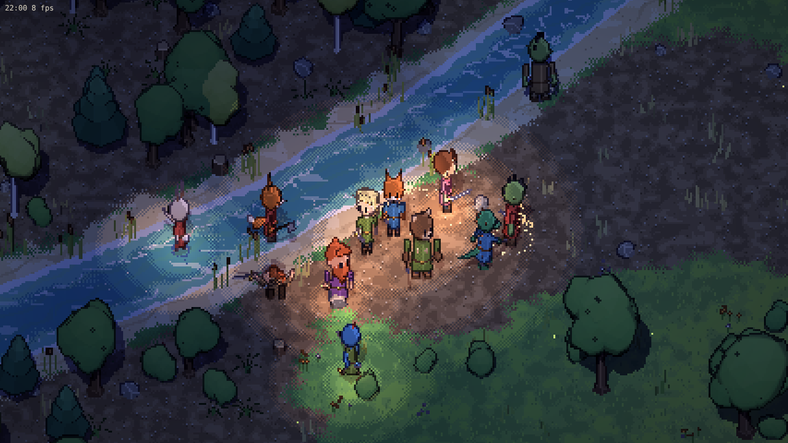
*The same place at 22:00: moonlight, the player's lantern and a few NPC lanterns (stepped light pools), fireflies.*

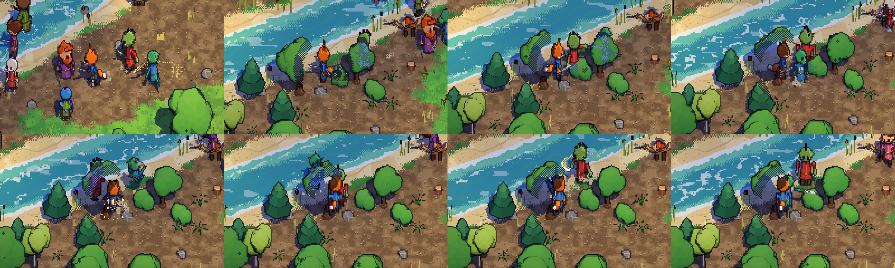
*A fight in the live game, eight frames about 0.25 s apart, unscaled crops. The scripted player swings into a
sparring pair, gets hunted, rolls and swings again. Note the hit sparks, the slash ribbon, the foliage cutaway
around the player (a hole with a dithered rim), and the wading splashes.*

## The prototype at real size

| Desktop 1280x720 | |
|---|---|
| 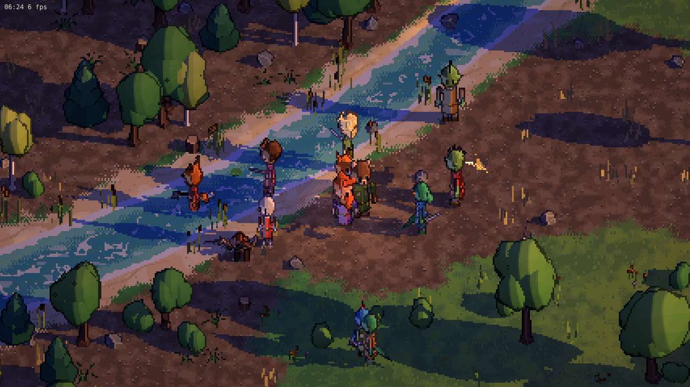 | 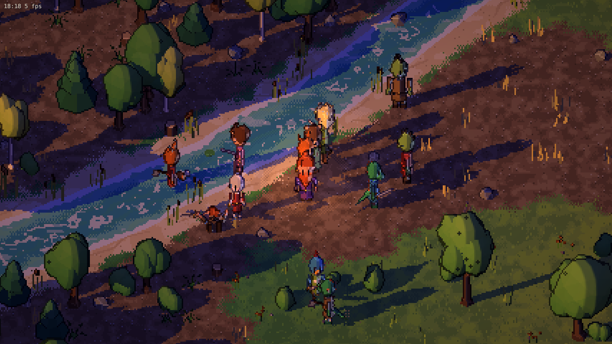 |
| dawn 06:24 | dusk 18:18 |

| Phone 390x844 (DPR 3, shown at CSS size; 1 texel = 2 px) | |
|---|---|
| 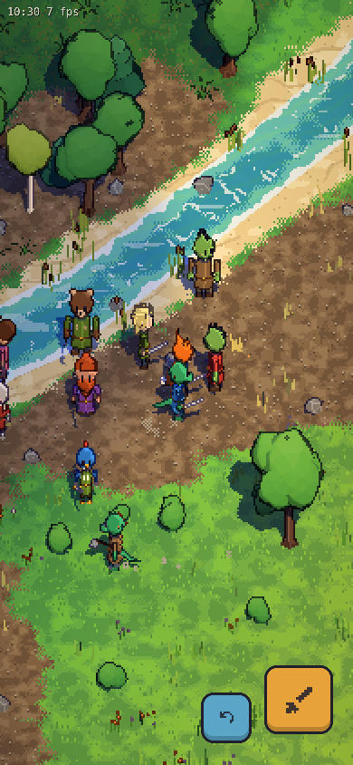 | 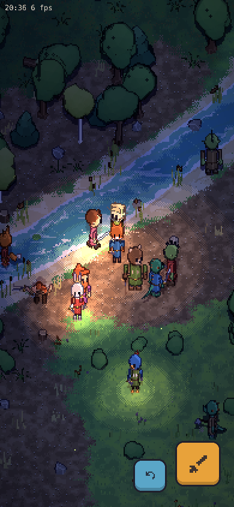 |

The phone shows the touch controls: a floating stick on the left half, attack and roll buttons on the right.

## Biomes and borders

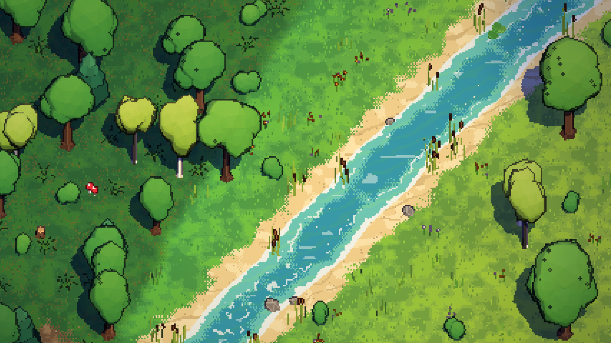
*Forest | river | meadow. Grass colour comes from the continuous worldgen fields, so the forest floor darkens into
the meadow without a seam. The river has a sand bank, reeds, lily pads, flow and foam.*

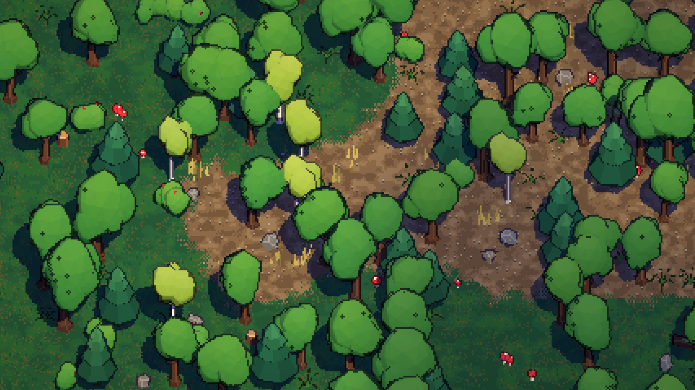
*Forest: oaks, pines, birches, ferns, red mushrooms (they glow teal at night), logs and stumps on a darker floor
with leaf litter.*

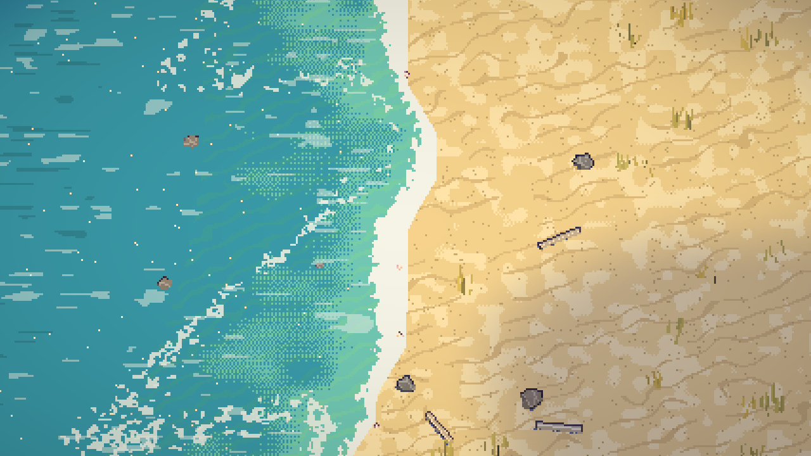
*Ocean coast: depth bands with dithered steps, a breathing foam rim, a broken second wave line, wind-rippled
sand, driftwood, shells and dry grass.*

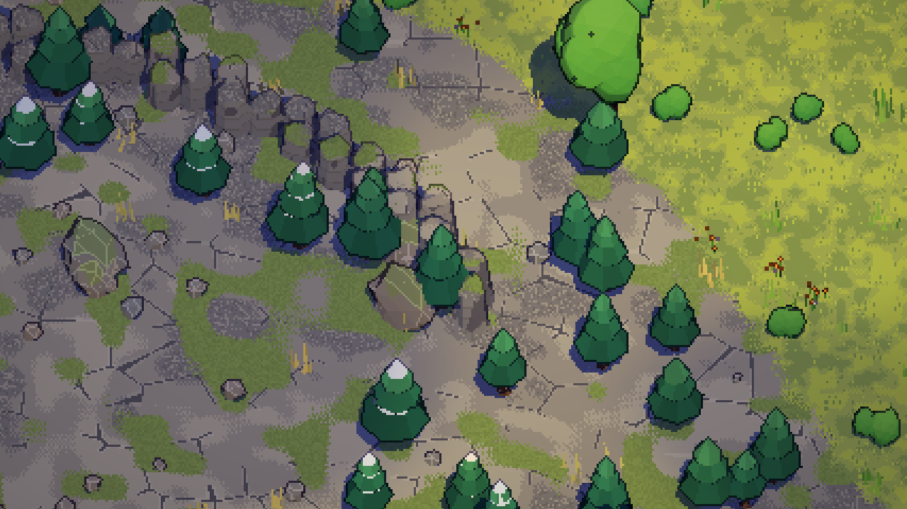
*Mountain highlands at the meadow border: weathered slabs, alpine grass in hollows, snow-dusted pines. The sim's
Cliff tiles become a ridge of rock columns, and the sim's gaps in the ridge read as passes.*

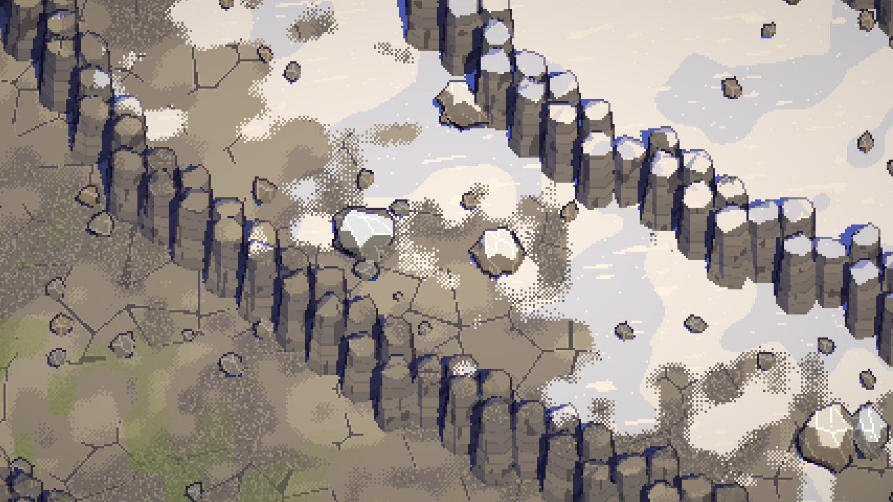
*High mountains (seed 4): the snow line with a dithered edge, basalt-column ridges with snow caps, snowy boulders.*

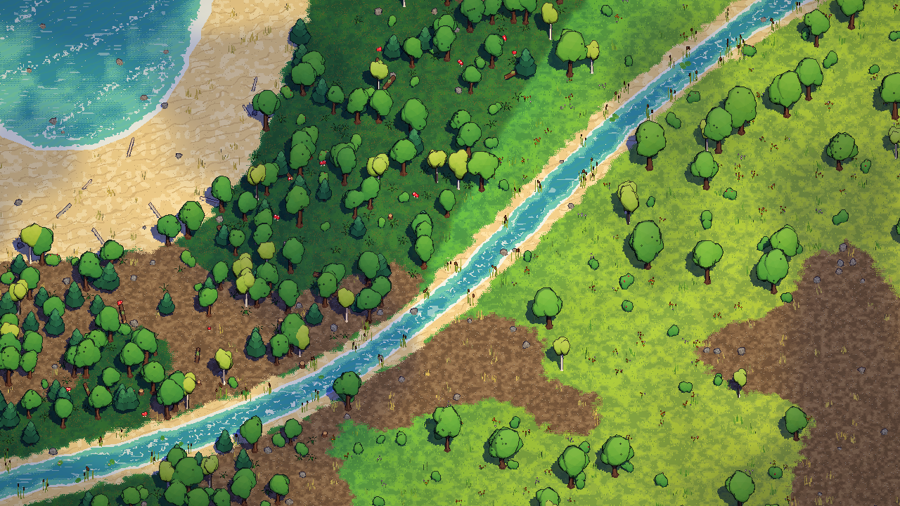
*1 texel = 1 px over about 80x57 tiles: the "300th tree" check. Groves cluster, no stamp repeats, and the biome
borders blend.*

## Species

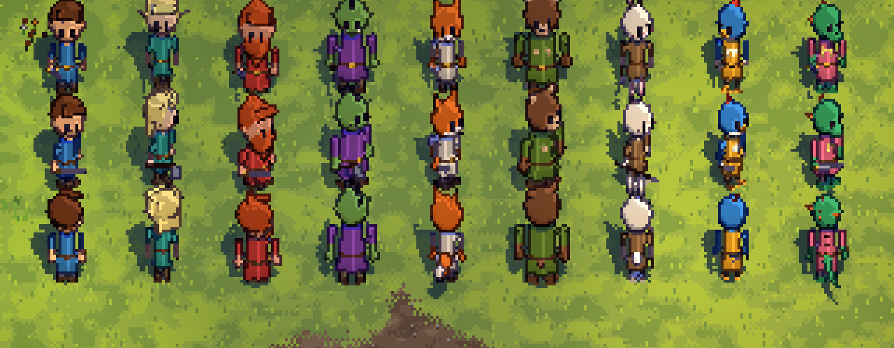
*Nine species on one 13-bone rig, front, three-quarter and back (scale 4). Left to right: human, elf, dwarf, orc,
foxfolk, bearfolk, rabbitfolk, birdfolk, lizardfolk. Silhouette first: ears, snout, tail and proportions name
each one.*

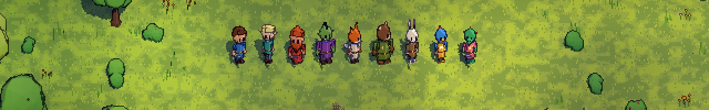
*The same lineup at a smaller scale (2 px per texel) on a 1280x200 strip.*

## Motion

All clips are procedural and pure functions of time. Their timing comes from the sim's action durations.

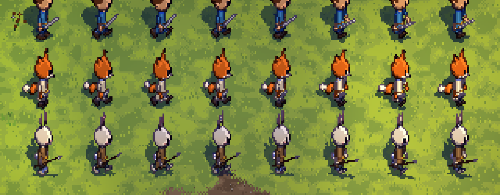
*Walk, 8 phases (human, foxfolk, rabbitfolk). Ears and tails lag behind the bob.*

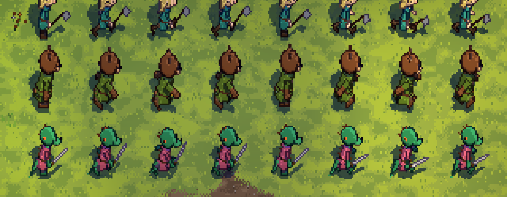
*Run, 8 phases (elf, bearfolk, lizardfolk), side view.*

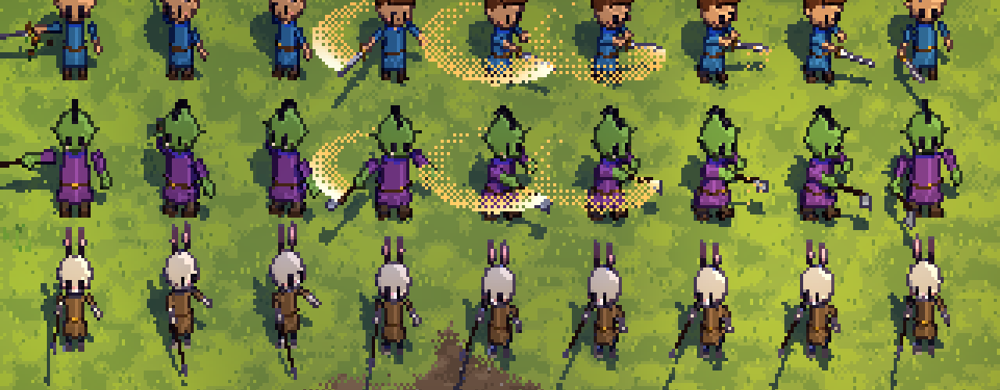
*Attack over the sim's 0.4 s. Wind-up, the strike (the hit lands at 37.5 %), hold and recover. The sword traces
a dithered slash ribbon; the spear thrusts.*

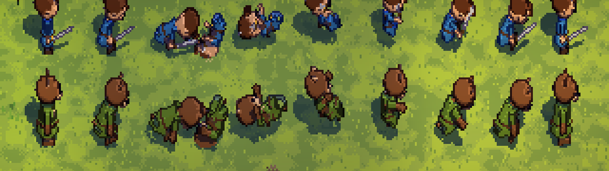
*Dodge roll over 0.35 s: crouch, tuck, a full roll about the body centre with a hop, land.*

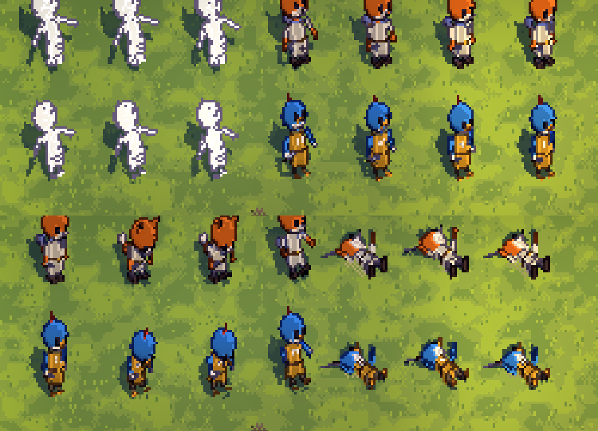
*Top: hurt (a white flash, snap back, recover). Bottom: death (buckle, fall back, bounce, stay, legs in the air).*

## Discarded explorations

See [EXPLORATION.md](EXPLORATION.md) for why each one died.

| | |
|---|---|
|  Paper theatre |  Ink and wash |
|  Voxel diorama |  The diorama's first frame |
|  No lean, no tilt: hats, not faces |  Flagstone mountains |
|  First mountain: a grey plain | |

## What is not built yet

- Gear layers, aging and scars on the rig. The rules for them are in DIRECTION.md §3.
- Monsters and other body plans.
- Weather (rain, snow fall) and seasons.
- UI beyond the touch buttons.
- Real-phone performance checks.

The two biggest open problems are the prop vertex budget on low-end phones and moving chunk building off the
main thread (INTEGRATION.md).
