# Mood board

These are Lucid's own images and the **style reference** for overgrown's art. Art agents study them and match the style.

**Use (Lucid, 2026-10-19):** these are Lucid's own images. They are the style reference, and they may also ship in-game, for example as title or loading art (overhaul plan D8). Lucid may add more at any time.

| # | Image | What to take from it |
|---|---|---|
| 01 | 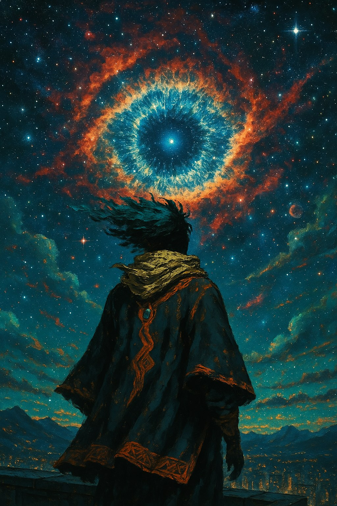 | Cosmic eye over a night city, teal sky against burnt-orange nebula, the wanderer from behind |
| 02 | 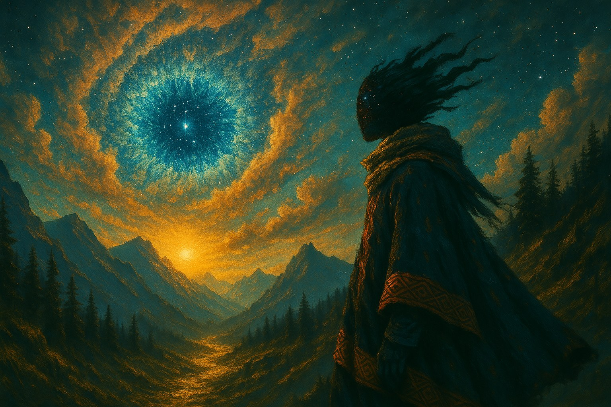 | A gold-lit valley path, pines, a mountain sun at the vanishing point |
| 03 | 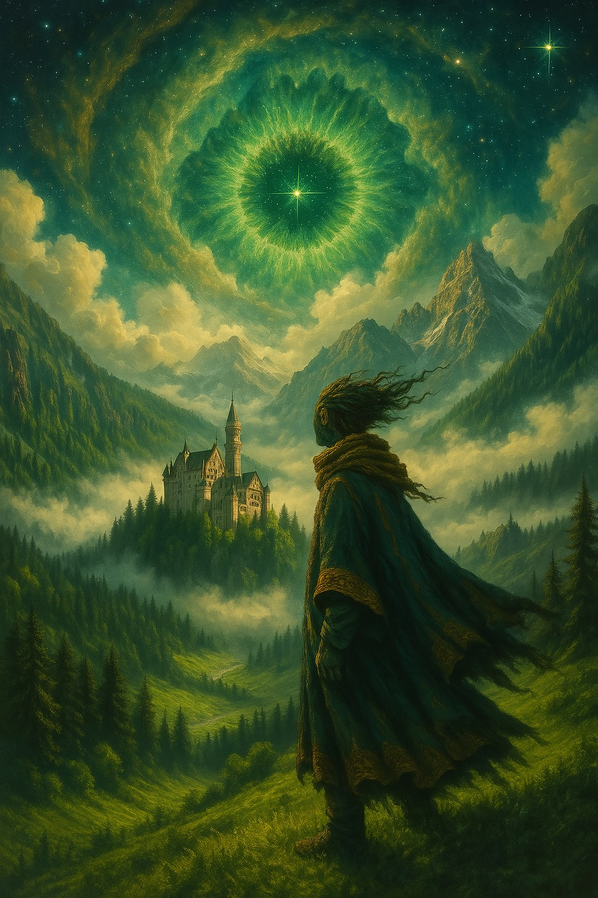 | A green-tinted biome: castle in mist, a sky that sets the whole palette |
| 04 | 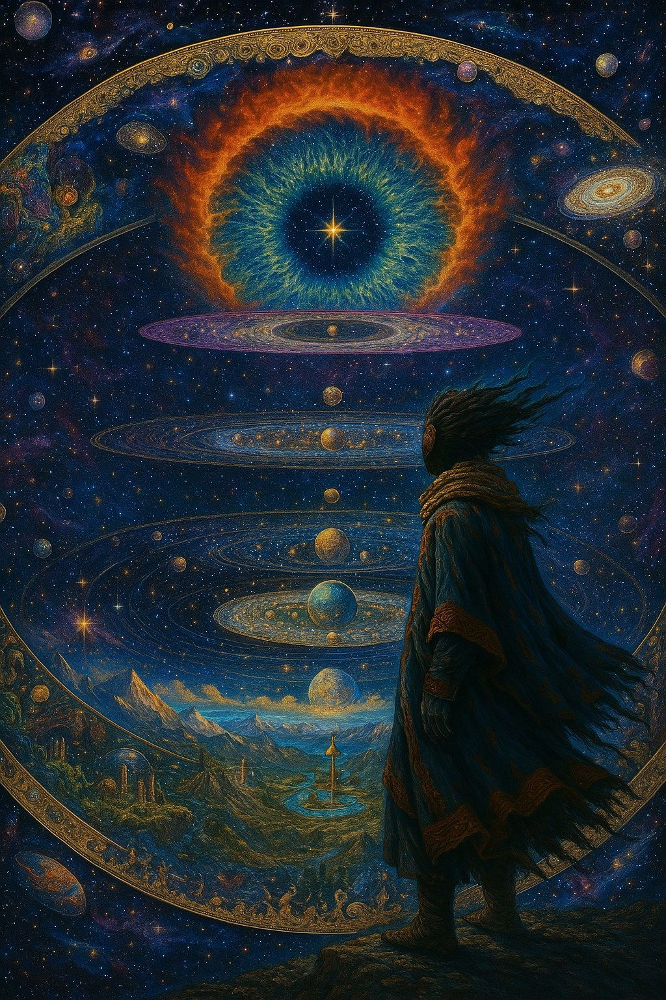 | Layered worlds and ornate gold rings, a mythic scale |
| 05 | 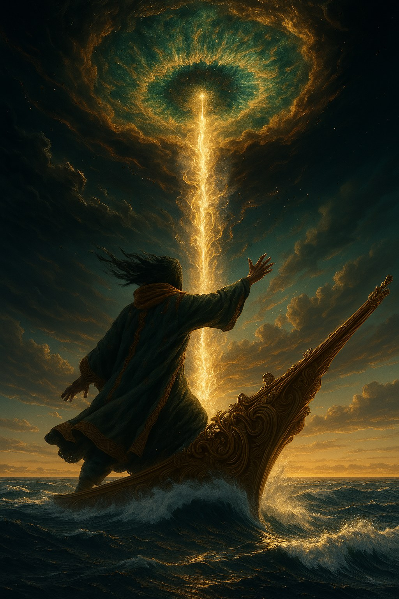 | Action and drama: a pillar of light, a carved prow, a stormy sea |
| 06 | 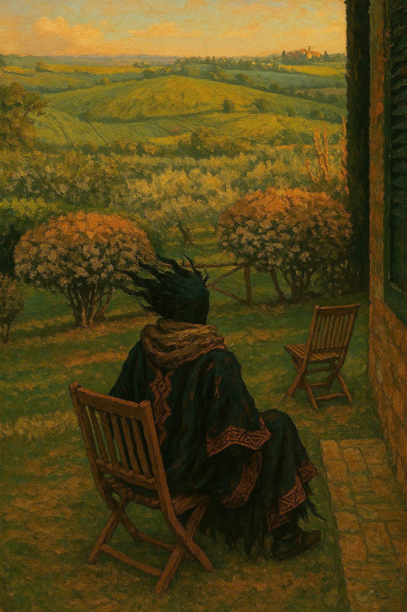 | The cozy register: a quiet dusk terrace over rolling hills |
| 07 | 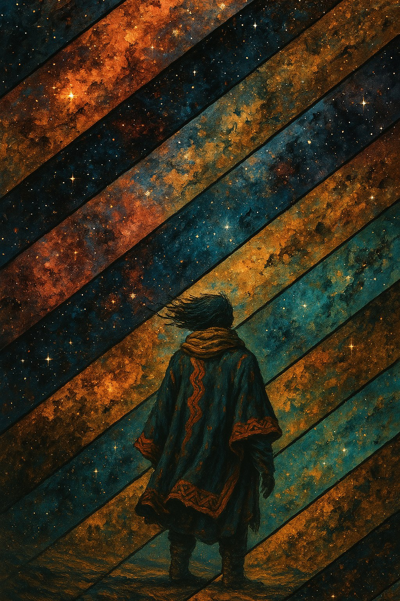 | Graphic stylisation: diagonal bands of painted cosmos |
| 08 | 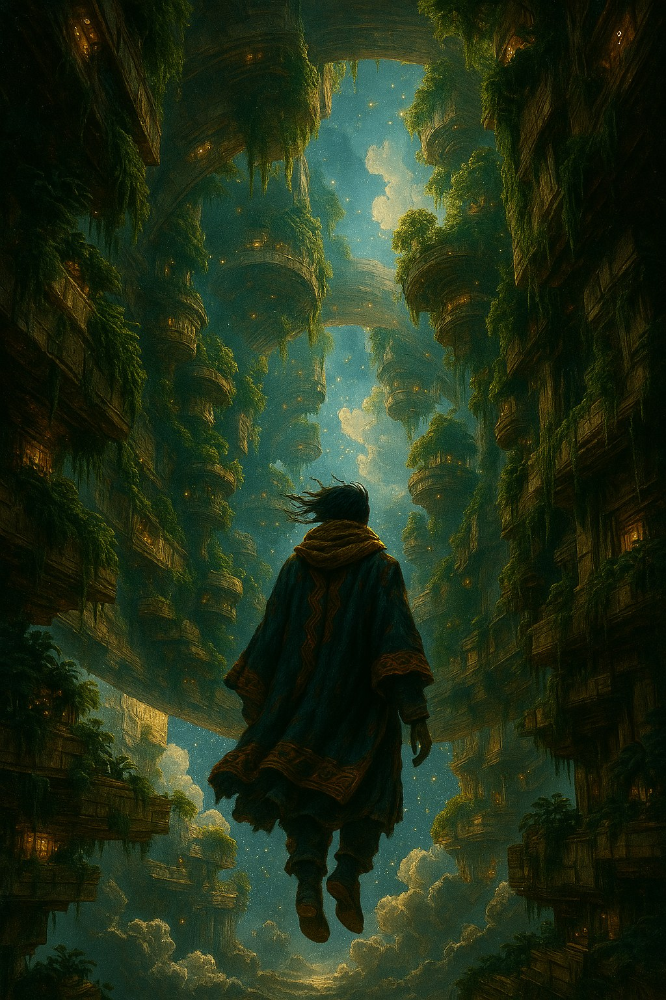 | "Overgrown": vines over a vertical city, warm windows, floating |
| 09 | 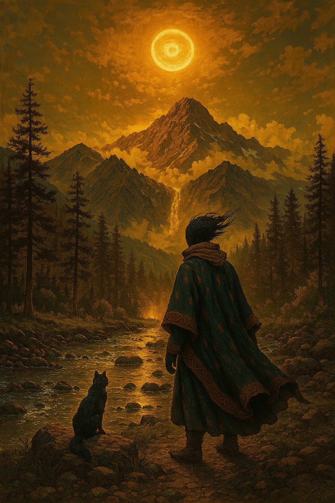 | Golden hour, a waterfall, a companion animal |
| 10 | 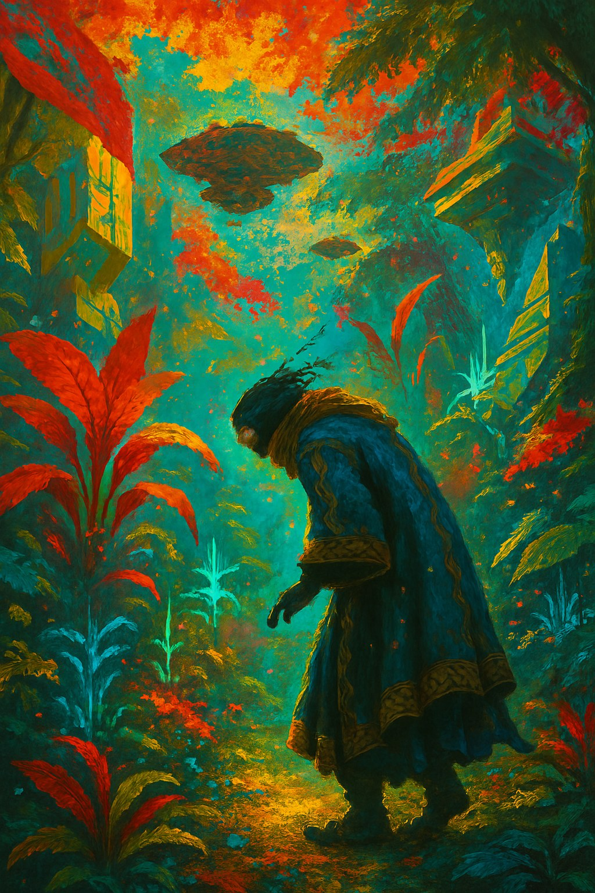 | A saturated jungle biome in red, teal and gold, with floating ruins |
| 11 | 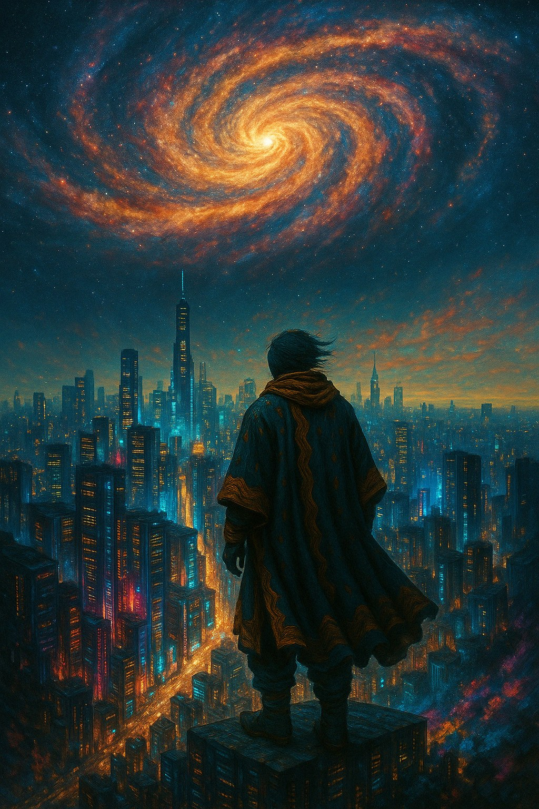 | A galaxy spiral over a modern-style city: scale and contrast |
| 12 | 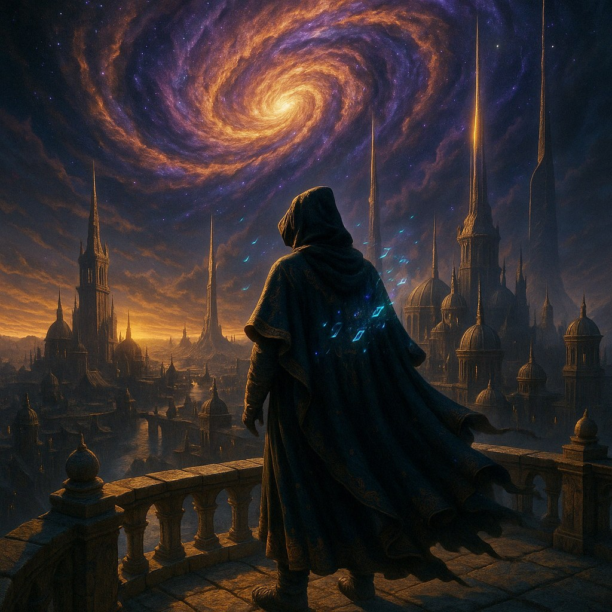 | Rune glyphs glowing on the cloak, spires, a hood variant |
| 13 | 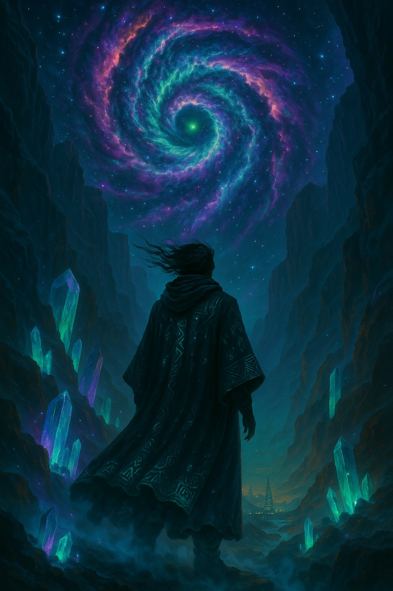 | A night canyon, glowing crystals, a purple and green vortex |

## Style traits (shared by all of them)
- **Painted look:** oil or impasto brushwork with visible strokes and a canvas or paper grain. Edges are soft, and detail lives in the brushwork, not in geometry.
- **Palette:** deep teal and blue grounds set against burnt orange and gold. Darks are very dark and lights glow. Each scene is tinted by its sky; image 03 is all green, image 09 all gold.
- **The sky is a character:** cosmic eyes, spirals and galaxies hang over every scene. It is the game's signature.
- **The wanderer:** a faceless figure in a dark poncho with orange geometric borders, a gold scarf and wind-blown dark hair, shown from behind or in three-quarter view and small against huge vistas. It is the north star for character design and for the game's identity, decided in OQ-036 (D6).
- **Wind everywhere:** hair, cloth, clouds and grass all move.
- **Scale:** small figure, huge world.
